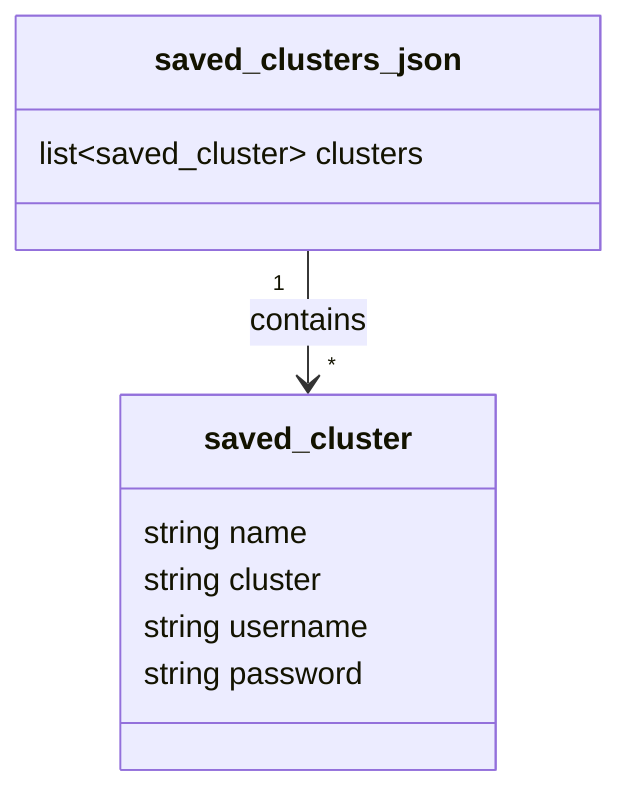
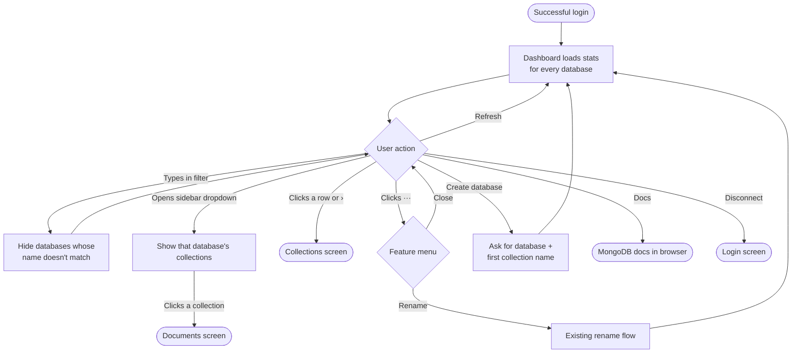
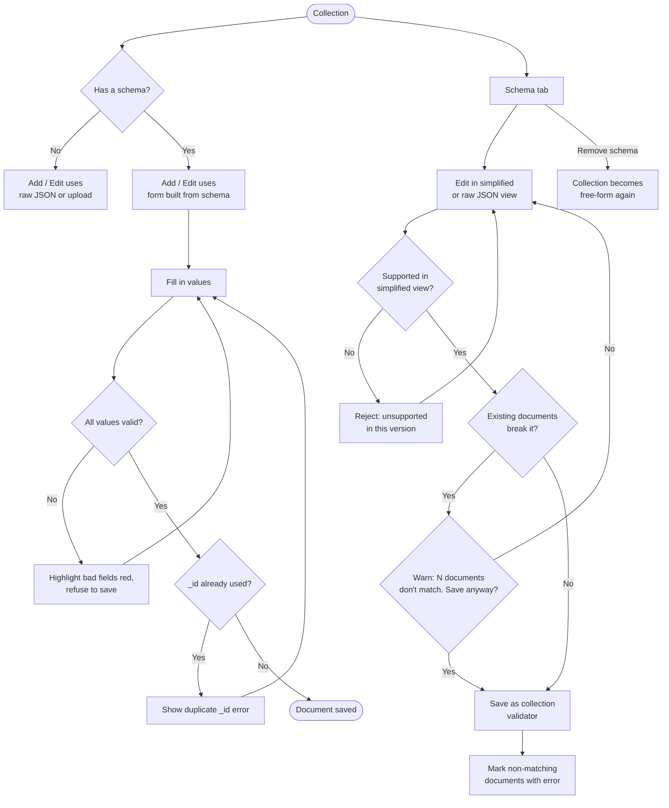

# Expected Behavior

## Login screen

The login page requires 3 things to login.

1. Cluster
2. Username
3. Password

The expected behavior is to input a cluster, a username, and a password, then you hit login and if the values work you go to the dashboard page. If any value is incorrect you are prompted to check a the values. A remember me section should create a local .json file that stores a `username`, `password`, and `cluster` for a cluster. So they exist in a list where the cluster can also have a `name` that the user can assign to a cluster so they can access it easier.

Clarifications:

- Credentials are only saved after a **successful** login, so bad values are never stored.
- Picking a saved cluster by its `name` fills in the cluster, username, and password fields.
- The `name` is optional. The "Cluster name (optional)" box only shows while **Remember me** is checked.
- The **Remember me** checkbox is on the login screen (checked by default). If it is **unchecked**, nothing is added to the local `.json` file, even when the login works.
- Logging in again to the same cluster + username updates that saved entry (new password, and the new name if one was typed) instead of adding a duplicate.
- The saved-clusters dropdown only appears when the `.json` file has at least one entry.
- The file lives in the user's home folder at `~/.db_gui/saved_clusters.json`, outside the repo, so saved logins can't be committed by accident.

> **Security note (deferred):** For now the password is stored in plain text in the local `.json` file. Later, it should be encrypted or moved to the OS keyring instead of being saved in the file.

### Login flow

#### Remember me storage

---

## Dashboard

The dashboard shows the all the clusters contents.

1. A list of the databases dropdowns to see associated collections.
2. A list of databases that shows database names with stats of their `collections`, `documents`, `data_size`, `storage_size`, and `...`
3. The `...` allows a list of features to pop up, and a close button.
4. A filter bare that lets you type in the name of a database to find faster, filtering should hide the other databases that don't match
5. A header, CURRENTLY DISABLED

Clarifications:

- Header controls (workspace picker, search, help, avatar) look normal but are **disabled**, not grayed out, so each can be switched on as its feature is built. Only `Docs` works.
- Clicking a database row (or its `›`) opens the existing collections screen. Clicking a collection in a sidebar dropdown opens the existing documents screen.
- The sidebar dropdowns load a database's collections the first time they're opened.
- Filtering is case-insensitive and matches anywhere in the name. The footer shows "Showing X of Y databases".
- Also on the dashboard: stat cards (databases, collections, documents, storage size totals), a connection banner (name, Healthy/Unreachable, host), a working **Create database** button and **Refresh** button, and a status bar (ping, MongoDB version, replica set).
- `storage_size` includes indexes ("Sizes include data and indexes"). A database the user can't read stats for shows `—`.
- MongoDB has no database descriptions, so only `admin`, `local`, and `config` get a subtitle ("System database").
- **Disconnect** is at the bottom of the sidebar and returns to the login screen.
- The "All databases" filter button and "View connection" are placeholders (disabled) for now.
- Stats load on a background thread, so the window stays responsive. Refresh is disabled while a load is running.

### Pop-ups

Styled after `design/Create database — pop-up.png` and `design/Rename database — pop-up.png`. The screen behind is dimmed, and each pop-up has a × close button, **Cancel**, and a green primary button. Enter submits and Esc cancels. An empty field shows "<field> is required." inside the pop-up.

- **Create database** asks for the **Database name** and a **First collection name**. MongoDB only keeps a database that has at least one collection, so this second field is a deliberate addition to the design. If the server refuses (for example, the name is taken), the error shows inside the pop-up and it stays open.
- **Rename database** opens from the `···` menu with the current name filled in. Keeping the same name shows "Choose a different name." After you click Rename, the existing confirmation (local BSON archive warning) still appears before anything changes.
- **Rename confirm + result** (styled after `design/Rename confirm popups.png`) are in-app pop-ups too, not Windows prompts. The confirm shows "Rename 'a' to 'b'?" in bold with the archive warning under it, plus **Yes** / **No**. ✕ or Esc means No. Afterwards, a result pop-up with **OK** says the rename worked. A warning version appears if the local archive couldn't be cleaned up, and an error version if the rename failed.
- Every other message in the app (e.g. "Cluster not saved") uses the same in-app pop-up. No native `messagebox` prompts are left.

### Dashboard flow

---

## Collections page

Styled after `design/Collections.png`. It uses the same frame as the dashboard (header, sidebar, status bar) and opens when you click a database: a table row, its `›`, or the database's **name** in the sidebar. (The sidebar chevron only shows/hides that database's collections.)

- The open database is **highlighted green and expanded** in the sidebar, with a table icon next to each collection.
- Breadcrumb: `<cluster> / Databases / <database>`. The first two, and the sidebar's **Databases** item, go back to the dashboard.
- **Create collection** (green button) opens the same style of pop-up as Create database.
- Tabs: **Collections N** (active) and **Statistics** (drawn but disabled for now).
- Stat cards: **Documents** (across N collections), **Data size** (average document size), **Storage size** (includes indexes), **Indexes** (total index size).
- Toolbar: filter box (same rules as the dashboard), **Name: A–Z / Z–A** sort toggle, **Refresh**.
- Table: collection name, documents, data size, indexes, index size, and **fields**. Fields is the number of distinct top-level field names in a sample of up to 100 documents, so it's an estimate.
- Clicking a collection row (or `›`) opens the existing documents screen. Clicking a collection in the sidebar does the same.
- Each row's `···` opens the feature menu with **Rename** (collection). The pop-up has the current name filled in. Renaming happens in place (MongoDB `renameCollection`, no archive needed). Taken or invalid names show an error inside the pop-up.
- There's no "More" button (removed from the design). Per-collection features live in the row `···` menu.
- Like the dashboard, everything loads on a background thread.

### List of features

Currently we only have `rename` feature

The `···` menu is styled after `design/Database features.png`. It's a small card under the button with one row per feature (icon + label, green highlight on hover), a divider, then **Close**. It closes when you pick a feature, click Close, press Esc, or click anywhere outside it. To add a feature, add a `MenuItem` in `DatabaseRow.build_menu_items()` (`src/db_gui/gui/widgets/database_table.py`).

### Header

> Implemented with the clean link `https://www.mongodb.com/docs/`. The link above carries Google ad-tracking parameters (`gclid`, `utm_*`, …), which shouldn't be shipped. To change it, edit `DOCS_URL` in `src/db_gui/gui/widgets/dashboard_header.py`.

## Documents Page

The way this page is currently done is you can make raw json or upload a json document, however this app is intended to be easier to use from a consumer standpoint.

The goal of this page is to let a collection have a **schema** (a layout of its fields and their types). Once a schema exists, **Add** opens a form built from it, so the user only fills in values instead of writing JSON. Collections without a schema keep the current raw JSON / upload behavior.

### Schema

A schema is stored in MongoDB itself as the collection's `$jsonSchema` validator, so everyone connected to the cluster sees the same one. Schemas are **strict**: a document that doesn't match is rejected, and extra fields are not allowed. To allow more or restrict more, the user edits the schema.

- A schema is **optional**. It can be added when a collection is created or at any time later. A **Remove schema** option turns the collection back into a free-form one.
- Each field has a **name**, a **type**, and a **Required** checkbox.
- Types: `string`, `int`, `long`, `double`, `decimal`, `bool`, `date`, `ObjectId`, and **array of** any one of those.
- Optional (not required) fields may be left out or set to `null`. Required fields must always have a value of the declared type.
- **Min / max** (optional, not required to set):
  - `string`: min/max length.
  - `int`, `long`, `double`, `decimal`: min/max value.
  - arrays: min/max number of items.
- Arrays hold **one strict type**. Mixed arrays (e.g. strings and ints together) are not allowed. An empty array is allowed for now.
- `_id` is allowed by every schema automatically.
- Nested objects are **deferred** (later version).

### Schema tab

Each collection gets a **Schema** tab with two views the user can switch between:

1. **Simplified**: a table of fields (name, type, required, min/max) where rows can be added, edited, and removed.
2. **Raw JSON**: the actual `$jsonSchema`, **editable**. Edits made here show up in the simplified view and the other way around.

Clarifications:

- If the raw JSON uses something the simplified view can't show (nested objects, regex patterns, allowed-value lists, etc.), saving is **rejected** with an "unsupported in this version" error.
- Before saving (adding a schema to a collection with data, or editing an existing one), the app checks existing documents and warns: "N documents don't match this schema. Save anyway?" The user can cancel.
- Invalid JSON shows an error inside the tab and nothing is saved.
- Switching between Simplified and Raw JSON converts what's on screen. If it can't (bad JSON, unsupported rule), the error shows and the view doesn't switch.
- A schema with no fields can't be saved (it would reject every document). Use **Remove schema** instead.
- If the saved schema is unsupported (e.g. someone set it outside this app), the tab opens in Raw JSON with the error.

### Add document page

Styled after `design/Add document.png`. **Add document** on the documents screen opens this page (it replaced the old pop-up). Until the schema form (below) is built, every collection uses this JSON editor.

- Same frame as the dashboard. Breadcrumb: `<cluster> / <database> / <collection> / Add document`, each part a link. **Back to documents** and **Cancel** return to the documents screen.
- Banner: "You are connected to <cluster name>. This document will be inserted when you select Insert document." It has no READ / WRITE tag, because the app doesn't check user roles.
- JSON editor: line numbers, syntax colors, current-line highlight, **Format JSON** (re-indents, leaves Extended JSON as typed), and a footer with "Valid document" or the JSON error, plus Ln/Col, UTF-8, and size. Tab inserts two spaces.
- **Insert document** is disabled while the JSON is invalid. Ctrl+Enter also inserts. On success the page goes back to the documents screen. Errors (duplicate `_id`, schema rejection, permissions) show in the footer and the page stays open.
- Document details: destination (database + collection), Document ID and BSON data types notes, a **Schema** line ("Enforced" or "None"), and an Extended JSON reference link. The design's "Validate before insert" checkbox was replaced by the Schema line, because schemas are strict and validation can't be switched off.

### Insert / edit form

When a collection has a schema, **Add** and **Edit** both open a form generated from it instead of the JSON box.

- One labeled input per field, matched to its type: text box for strings and numbers, checkbox for `bool`, text box for `date` in `YYYY-MM-DD` format (e.g. `2026-11-23`), and a list editor for arrays (add/remove items of the declared type).
- Required fields are marked. Optional fields can be left empty, which saves as `null`.
- `_id` is shown at the top of the form:
  - On **insert** it's optional. If left empty, MongoDB generates one.
  - If the `_id` is already used in the collection, show an error ("A document with this _id already exists.") and keep the form open.
  - On **edit** it's shown but read-only, since MongoDB doesn't allow changing an existing `_id`.
- Values are converted to their declared type before saving. Anything invalid (wrong type, out of min/max range, missing required value) is **highlighted red** and the form refuses to save until it's fixed.

Clarifications (insert form, built):

- The form replaces the JSON editor on the **Add document page** once the page finds the collection's schema. If the schema has rules the form can't show, the page keeps the JSON editor (MongoDB still checks the document).
- `bool` is a **true / false** dropdown rather than a checkbox, so an optional bool can also be left empty (`null`).
- An array with no items saves as an empty list `[]`, not `null`, since arrays are allowed to be empty. Empty items inside an array are errors.
- `_id` typed as a 24-character hex string is saved as an ObjectId; anything else is saved as text. If the schema defines `_id` itself, it appears as a normal field instead.
- `long` values are saved as 64-bit integers and `decimal` as Decimal128, so they match the schema type even for small numbers.
- **Edit is deferred** to its own ticket: the app has no way to open a single document yet.

### Documents that break the schema

A schema can be added to a collection that already has documents that don't match (after the warning above). MongoDB keeps those documents, but rejects any update to them until they match.

- The documents page marks these documents with an **error indicator** ("Doesn't match schema"). They are found with a `$nor: [{ $jsonSchema: ... }]` query, so MongoDB does the checking.
- Marked rows are tinted red with "⚠ Doesn't match schema", and the status line adds "· N don't match the schema". Only the documents on screen (the newest 100) are checked.
- The markers refresh after the schema is saved or removed in the Schema tab, and after documents are added. If the check fails, the list still shows, just without markers.
- Opening one in the edit form highlights the bad fields in red, and saving is refused until they're fixed. *(Deferred with the edit form.)*

### Schema flow

