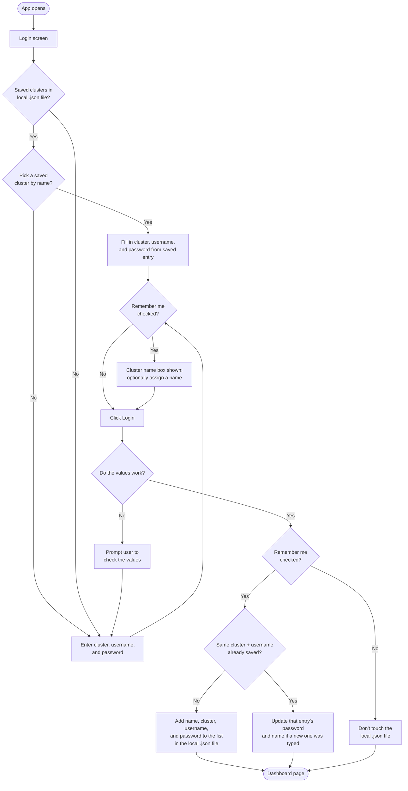
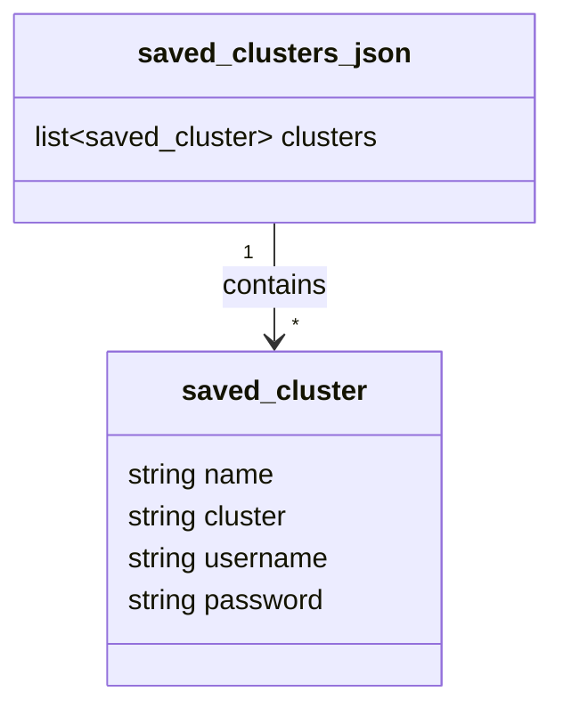

# Expected Behavior

## Login screen

The login page requires 3 things to login.

1. Cluster
2. Username
3. Password

The expected behavior is to input a cluster, a username, and a password, then you hit login and if the values work you go to the dashboard page. If any value is incorrect you are prompted to check a the values. A remember me section should create a local .json file that stores a `username`, `password`, and `cluster` for a cluster. So they exist in a list where the cluster can also have a `name` that the user can assign to a cluster so they can access it easier.

Clarifications:

- Credentials are only saved after a **successful** login, so bad values are never stored.
- Picking a saved cluster by its `name` fills in the cluster, username, and password fields.
- The `name` is optional. The "Cluster name (optional)" box only shows while **Remember me** is checked.
- The **Remember me** checkbox is on the login screen (checked by default). If it is **unchecked**, nothing is added to the local `.json` file, even when the login works.
- Logging in again to the same cluster + username updates that saved entry (new password, and the new name if one was typed) instead of adding a duplicate.
- The saved-clusters dropdown only appears when the `.json` file has at least one entry.
- The file lives in the user's home folder at `~/.db_gui/saved_clusters.json`, outside the repo, so saved logins can't be committed by accident.

> **Security note (deferred):** For now the password is stored in plain text in the local `.json` file. Later, it should be encrypted or moved to the OS keyring instead of being saved in the file.

### Login flow

#### Remember me storage

---

## Dashboard

The dashboard shows the all the clusters contents.

1. A list of the databases in said cluster.
2. 
