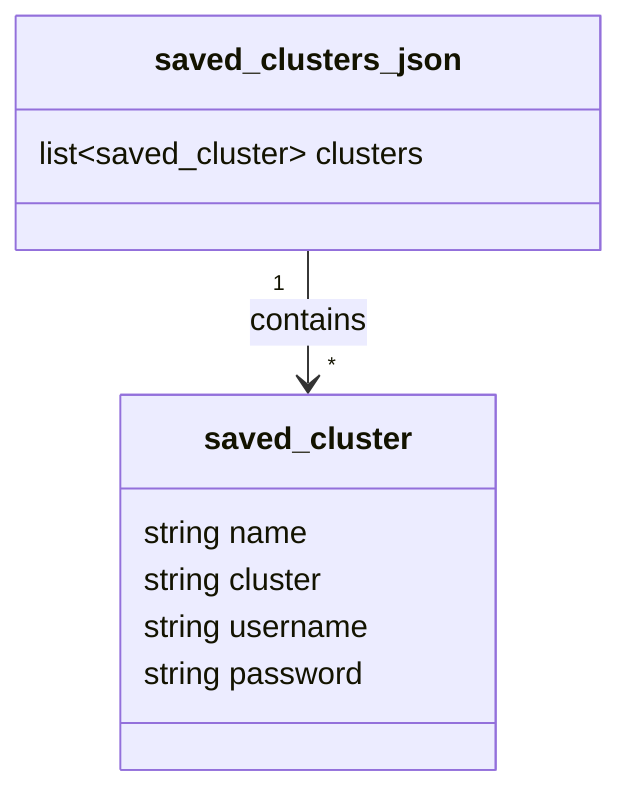

# Expected Behavior

## Login screen

The login page requires 3 things to login.

1. Cluster
2. Username
3. Password

The expected behavior is to input a cluster, a username, and a password, then you hit login and if the values work you go to the dashboard page. If any value is incorrect you are prompted to check a the values. A remember me section should create a local .json file that stores a `username`, `password`, and `cluster` for a cluster. So they exist in a list where the cluster can also have a `name` that the user can assign to a cluster so they can access it easier.

Clarifications:

- Credentials are only saved after a **successful** login, so bad values are never stored.
- Picking a saved cluster by its `name` fills in the cluster, username, and password fields.
- The `name` is optional. The "Cluster name (optional)" box only shows while **Remember me** is checked.
- The **Remember me** checkbox is on the login screen (checked by default). If it is **unchecked**, nothing is added to the local `.json` file, even when the login works.
- Logging in again to the same cluster + username updates that saved entry (new password, and the new name if one was typed) instead of adding a duplicate.
- The saved-clusters dropdown only appears when the `.json` file has at least one entry.
- The file lives in the user's home folder at `~/.db_gui/saved_clusters.json`, outside the repo, so saved logins can't be committed by accident.

> **Security note (deferred):** For now the password is stored in plain text in the local `.json` file. Later, it should be encrypted or moved to the OS keyring instead of being saved in the file.

### Login flow

#### Remember me storage

---

## Dashboard

The dashboard shows the all the clusters contents.

1. A list of the databases dropdowns to see associated collections.
2. A list of databases that shows database names with stats of their `collections`, `documents`, `data_size`, `storage_size`, and `...`
3. The `...` allows a list of features to pop up, and a close button.
4. A filter bare that lets you type in the name of a database to find faster, filtering should hide the other databases that don't match
5. A header, THIS CURRENTLY SHOULDN"T WORK, so just gray out the functionality

Clarifications:

- Header controls (workspace picker, search, help, avatar) look normal but are **disabled**, not grayed out, so each can be switched on as its feature is built. Only `Docs` works.
- Clicking a database row (or its `›`) opens the existing collections screen. Clicking a collection in a sidebar dropdown opens the existing documents screen.
- The sidebar dropdowns load a database's collections the first time they're opened.
- Filtering is case-insensitive and matches anywhere in the name. The footer shows "Showing X of Y databases".
- Also on the dashboard: stat cards (databases, collections, documents, storage size totals), a connection banner (name, Healthy/Unreachable, host), a working **Create database** button and **Refresh** button, and a status bar (ping, MongoDB version, replica set).
- `storage_size` includes indexes ("Sizes include data and indexes"). A database the user can't read stats for shows `—`.
- MongoDB has no database descriptions, so only `admin`, `local`, and `config` get a subtitle ("System database").
- **Disconnect** is at the bottom of the sidebar and returns to the login screen.
- The "All databases" filter button and "View connection" are placeholders (disabled) for now.
- Stats load on a background thread, so the window stays responsive. Refresh is disabled while a load is running.

### Pop-ups

Styled after `design/Create database — pop-up.png` and `design/Rename database — pop-up.png`. The screen behind is dimmed, and each pop-up has a × close button, **Cancel**, and a green primary button. Enter submits and Esc cancels. An empty field shows "<field> is required." inside the pop-up.

- **Create database** asks for the **Database name** and a **First collection name**. MongoDB only keeps a database that has at least one collection, so this second field is a deliberate addition to the design. If the server refuses (for example, the name is taken), the error shows inside the pop-up and it stays open.
- **Rename database** opens from the `···` menu with the current name filled in. Keeping the same name shows "Choose a different name." After you click Rename, the existing confirmation (local BSON archive warning) still appears before anything changes.
- **Rename confirm + result** (styled after `design/Rename confirm popups.png`) are in-app pop-ups too, not Windows prompts. The confirm shows "Rename 'a' to 'b'?" in bold with the archive warning under it, plus **Yes** / **No**. ✕ or Esc means No. Afterwards, a result pop-up with **OK** says the rename worked. A warning version appears if the local archive couldn't be cleaned up, and an error version if the rename failed.
- Every other message in the app (e.g. "Cluster not saved") uses the same in-app pop-up. No native `messagebox` prompts are left.

### Dashboard flow

### List of features

Currently we only have `rename` feature

The `···` menu is styled after `design/Database features.png`. It's a small card under the button with one row per feature (icon + label, green highlight on hover), a divider, then **Close**. It closes when you pick a feature, click Close, press Esc, or click anywhere outside it. To add a feature, add a `MenuItem` in `DatabaseRow.build_menu_items()` (`src/db_gui/gui/widgets/database_table.py`).

### Header

The link in the header to `Docs` should take you to this link, `https://www.mongodb.com/docs/?utm_source=google&utm_campaign=search_gs_pl_evergreen_atlas_general_retarget-brand-ftusers_gic-null_ww-multi_ps-all_desktop_eng_lead&utm_term=mongodb&utm_medium=cpc_paid_search&utm_ad=p&utm_ad_campaign_id=23238673915&adgroup=199318467358&cq_cmp=23238673915&gad_source=1&gad_campaignid=23238673915&gbraid=0AAAAADQ1400Y6wVQLMIoej6GEF8rkLIx_&gclid=CjwKCAiA5Y_YBhBbEiwAK5Dl7QBD5QBGpShfT1RVs2IriMygvYiBvWGLlxiqFLKICbG0VCETRqgCmRoCu00QAvD_BwE`

> Implemented with the clean link `https://www.mongodb.com/docs/`. The link above carries Google ad-tracking parameters (`gclid`, `utm_*`, …), which shouldn't be shipped. To change it, edit `DOCS_URL` in `src/db_gui/gui/widgets/dashboard_header.py`.